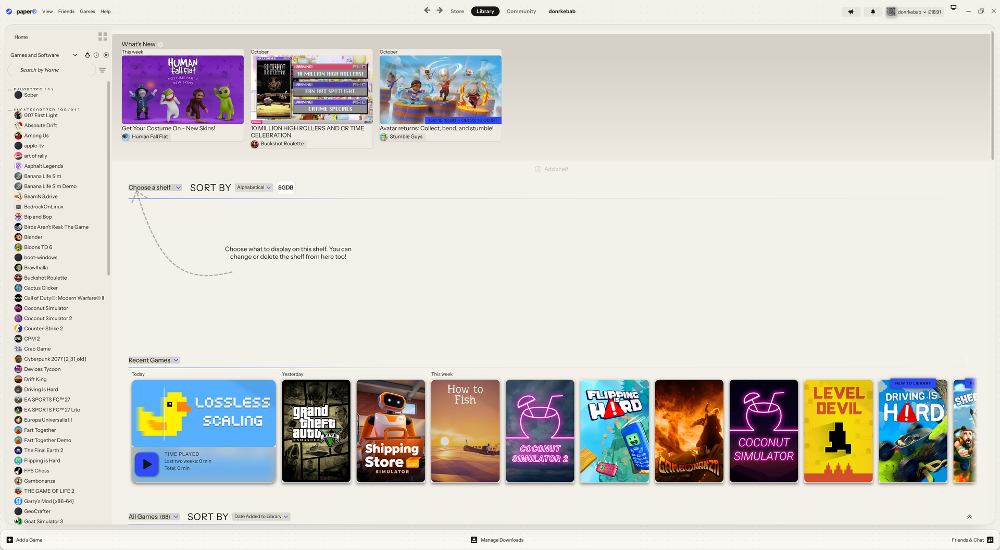
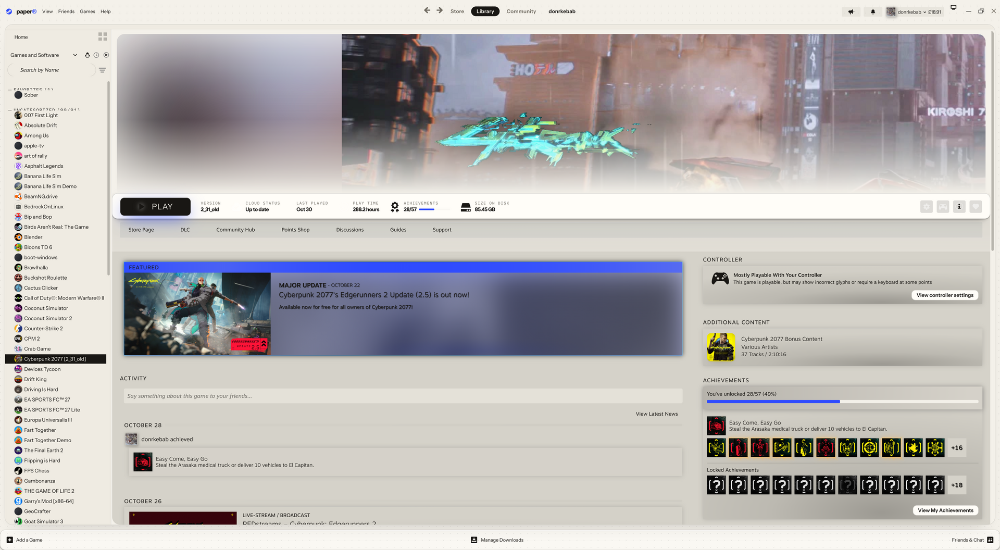
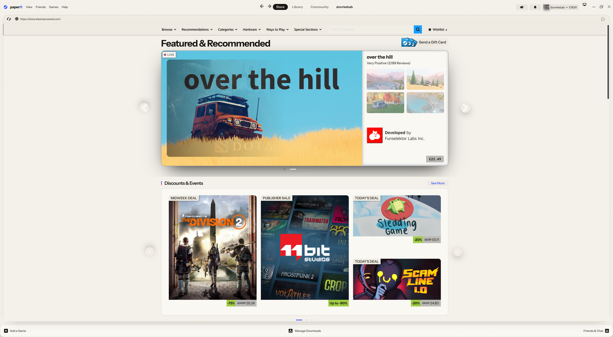

# Paper

A light theme for the Steam desktop client: warm paper, ink-black type, a cobalt accent and soft printed-page shadows.

**Includes:** library, game pages, store and community pages, friends and chat, notifications, menus, sign-in screen, downloads.

## Screenshots




## Install
Requires [Millennium](https://steambrew.app). Open Steam → Millennium → Themes → Install a theme, and paste:
```
https://github.com/ethembeldagli/steam-paper
```

## Settings
Steam → Millennium → Themes → Paper → ⚙
- **Accent color:** Cobalt, Forest, Ink red, Graphite
- **Corners:** default, sharp, extra round
- **Motion:** full or reduced
- **Backdrop:** on or off

## License
MIT
